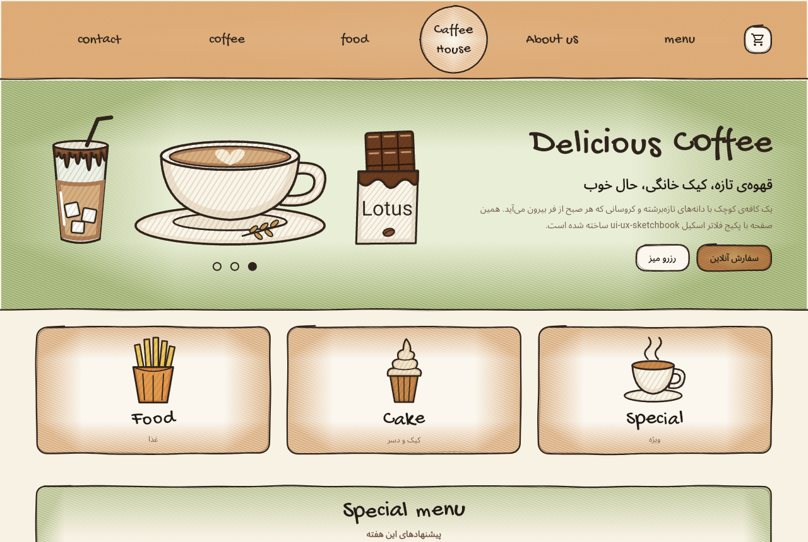
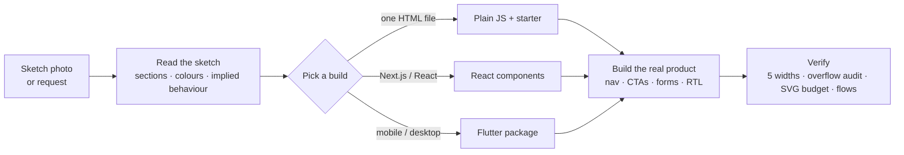

<div align="center">

# ✎ ui-ux-sketchbook

### Turn a sketch on paper into a real, responsive product that still looks hand-drawn.

An agent skill for **Claude Code, Codex, Cursor, Hermes Agent** and any agent that reads `SKILL.md`.<br>
It ships one design language in three builds: **plain JavaScript**, **React / Next.js** and **Flutter** (Android · iOS · web · desktop).

[](https://github.com/TssHack/ui-ux-sketchbook/actions/workflows/ci.yml)
[](https://github.com/TssHack/ui-ux-sketchbook/releases/latest)
[](https://tsshack.github.io/ui-ux-sketchbook/)
[](skills/ui-ux-sketchbook/assets/flutter)
[](LICENSE)

[**Web demo**](https://tsshack.github.io/ui-ux-sketchbook/) · [**Flutter demo**](https://tsshack.github.io/ui-ux-sketchbook/flutter/) · [Install](#install) · [Builds](#three-builds-one-look) · [Docs](#reference) · [فارسی](README.fa.md)

&nbsp;

</div>

---

## Contents

- [Why](#why)
- [What you get](#what-you-get)
- [Install](#install)
- [Use it](#use-it)
- [Three builds, one look](#three-builds-one-look)
- [How it works](#how-it-works)
- [Reference](#reference)
- [Quality bar](#quality-bar)
- [FAQ](#faq)
- [Repository layout](#repository-layout)
- [Development](#development)
- [Contributing](#contributing) · [License](#license)

## Why

Ask a coding agent to "build this hand-drawn sketch" and you usually get one of two things. One is a **picture of the sketch**: a static page that copies the drawing, has nothing to click, and breaks below one screen size. The other is a **generic template** that throws the sketch's character away.

This skill teaches the agent to do what a designer and front-end developer would:

1. **Read the sketch for intent.** It notes the section order, brand marks and the pencil colour of each region. It also picks up behaviour: dots under a hero mean a carousel, a card cut off at the edge means a horizontal scroller, coloured ovals mean filters.
2. **Build the product the sketch represents.** That means navigation that works on a phone, clear calls to action, forms that validate, and a success state at the end of every flow.
3. **Keep the drawing's soul** with primitives that look hand-made and stay fast: wobbly ink outlines, coloured-pencil shading and hand lettering.

## What you get

| | |
|---|---|
| **Hand-drawn primitives** | Rough frames drawn with two passes of the pen, coloured-pencil shading that gathers at the edges, hand-lettered titles, and an illustration renderer with a pen-trace animation |
| **15 ready illustrations** | Iced coffee, latte, chocolate bar, fries, pizza, cupcake, cake slice, steaming cup, croissant, cheesecake, burger, pasta, hot chocolate, leaves and a coffee bean. The same data is used on every platform |
| **Three builds** | Plain JS (attributes, no framework), React / Next.js components, and a Flutter package with zero dependencies |
| **Starters** | A single-page HTML starter and a complete Flutter example app |
| **RTL done properly** | Persian and Arabic layouts, Latin lettering kept LTR inside them, the drawn order preserved, and Persian digits accepted in forms |
| **Fast by design** | No SVG or shader filters, a page-weight budget, a lite render for small icons, and cached geometry |
| **Responsive checklist** | Layout patterns that held from 320px to desktop, plus every bug this style has produced and how to avoid it |
| **Tooling** | An overflow audit, a single-file inliner and a validator; CI covers all three builds and both installers |

## Install

<details open>
<summary><b>Claude Code</b>: one command</summary>

```text
/plugin install ui-ux-sketchbook --marketplace TssHack/ui-ux-sketchbook
```

Older versions, or adding the marketplace yourself:

```text
/plugin marketplace add TssHack/ui-ux-sketchbook
/plugin install ui-ux-sketchbook@tsshack-skills
```
</details>

<details open>
<summary><b>Codex, Cursor and 40+ other agents</b>: the skills CLI</summary>

```bash
npx skills add TssHack/ui-ux-sketchbook            # pick agents interactively
npx skills add TssHack/ui-ux-sketchbook -a codex   # or name them: -a cursor, -a claude-code, ...
```
</details>

<details open>
<summary><b>Hermes Agent</b>, or any agent with the installer script</summary>

macOS / Linux:

```bash
curl -fsSL https://raw.githubusercontent.com/TssHack/ui-ux-sketchbook/main/install.sh | sh -s -- --agent hermes
```

Windows (PowerShell):

```powershell
& ([scriptblock]::Create((irm https://raw.githubusercontent.com/TssHack/ui-ux-sketchbook/main/install.ps1))) -Agent hermes
```

| Option | Values |
|---|---|
| `--agent` / `-Agent` | `claude`, `codex`, `cursor`, `hermes`, `all`. Default: every agent found on the machine, otherwise Claude Code |
| `--project` / `-Project` | install into the current project instead of your home folder |
| `--dir` / `-Dir` | install into any folder, for agents not listed |
| `--version` / `-Version` | a release tag such as `v1.1.0` (default: latest) |

The script copies the **whole** skill folder (assets included). `hermes skills install <url>` would fetch only `SKILL.md`.
</details>

<details>
<summary><b>Manual</b></summary>

Download `ui-ux-sketchbook.zip` from the [latest release](https://github.com/TssHack/ui-ux-sketchbook/releases/latest) (verify it with `SHA256SUMS`) and unzip it into your agent's skills folder:

| Agent | Global | Per project |
|---|---|---|
| Claude Code | `~/.claude/skills/` | `.claude/skills/` |
| Codex | `~/.codex/skills/` | `.agents/skills/` |
| Cursor | `~/.cursor/skills/` | `.cursor/skills/` |
| Hermes Agent | `~/.hermes/skills/` | — |
</details>

Restart the agent after installing. The skill triggers on its own when a request matches; you don't need to name it.

## Use it

Prompts that work well:

```text
This is a hand-drawn sketch of my café website. Build it as a real site that keeps the feel
of the drawing and works on phones. One index.html I can open directly.
```

```text
Landing page for my sister's bakery in Shiraz, like a page from a sketchbook drawn with pen and
coloured pencils: round logo in a top band, drawn breads, three cards, opening hours and a cake
order form. Persian, RTL.
```

```text
Turn this paper wireframe into a Flutter app for Android and iOS with the same hand-drawn look.
```

```text
Portfolio for a children's book illustrator: wobbly ink lines, pencil shading, hand-lettered
headings, doodles in the margins. Next.js.
```

The agent picks the build from your request: one HTML file means plain JS, a Next.js project means React, and Flutter or mobile / desktop means Flutter. Then it follows the skill's checklist through to a verified result.

## Three builds, one look

| | Plain JS | React / Next.js | Flutter |
|---|---|---|---|
| **For** | single HTML files, static sites, no framework | web apps that keep growing | Android, iOS, web, Windows, macOS, Linux |
| **Frame + shading** | `data-sketch data-tint="…"` | `<SketchBox tint="…">` | `SketchBox(tint: …)` |
| **Illustration** | `data-art="latte" data-draw-in` | `<Drawing spec={latte} />` | `SketchDrawing.named('latte', drawIn: true)` |
| **Hand lettering** | `data-hand` | `<HandText text="…" />` | `HandText('…')` |
| **Starter** | `assets/vanilla/starter.html` | — | `examples/flutter_cafe/` |
| **Dependencies** | none | React | Flutter SDK only |

<p align="center"><br><sub>The café rebuilt with the <b>Flutter</b> package (<a href="https://tsshack.github.io/ui-ux-sketchbook/flutter/">live</a>). Same drawings, same outlines, one codebase for mobile, web and desktop.</sub></p>

<table>
<tr><th>Plain JS</th><th>React</th><th>Flutter</th></tr>
<tr valign="top"><td>

```html
<section data-sketch="bottom"
         data-tint="#8fa45c">
  <h1><span data-hand>
    Delicious Coffee
  </span></h1>
  <span data-art="latte"
        data-draw-in></span>
</section>
```

</td><td>

```tsx
<SketchBox as="section"
  edges={["bottom"]}
  tint="#8fa45c">
  <h1><HandText
    text="Delicious Coffee" /></h1>
  <Drawing spec={latte}
    className="draw-in" />
</SketchBox>
```

</td><td>

```dart
SketchBox(
  edges: {SketchEdge.bottom},
  tint: SketchColors.sage,
  child: Column(children: [
    HandText('Delicious Coffee'),
    SketchDrawing.named('latte',
        drawIn: true),
  ]),
)
```

</td></tr>
</table>

## How it works



**Under the hood**

- **Outlines are geometry, not filters.** A seeded noise function pushes every sample of a rounded rectangle along its normal, and the stroke overshoots where the pen "lifts". Two passes, one faint, give the double-line look. Sample spacing grows with size, so big frames stay cheap.
- **Pencil shading** is a wash plus diagonal hatching, kept only near the edges: CSS masks on the web, a `BlendMode.dstIn` layer in Flutter.
- **Illustrations are data.** Each shape is an SVG path with a fill, a darker shading stroke clipped inside it, and two ink passes. The same specs render in all three builds. `tools/gen_flutter_art.js` generates the Dart library from the JS one, and CI fails if they drift apart.
- **The draw-in animation** traces the ink with a dash offset (web) or path metrics (Flutter), then fades the colour in. Both respect reduced-motion settings.

## Reference

| Document | What's inside |
|---|---|
| [`SKILL.md`](skills/ui-ux-sketchbook/SKILL.md) | The workflow the agent follows, build selection, rules, verification |
| [`references/responsive.md`](skills/ui-ux-sketchbook/references/responsive.md) | Widths to test, bugs specific to this style, layout patterns that held |
| [`references/drawing.md`](skills/ui-ux-sketchbook/references/drawing.md) | How illustration specs draw, a recipe for new ones, lessons learned |
| [`references/flutter.md`](skills/ui-ux-sketchbook/references/flutter.md) | Flutter setup, widget table, layout, RTL and performance |
| [`assets/vanilla/sketchbook.js`](skills/ui-ux-sketchbook/assets/vanilla/sketchbook.js) | Attribute API documented in the file header |
| [`CHANGELOG.md`](CHANGELOG.md) | What changed in each release |

## Quality bar

The skill makes the agent check these before it says "done", and CI enforces the parts that can be automated:

- [x] Works at **320, 375, 768, ~920 and 1280 px** with no sideways scroll (overflow audit script)
- [x] **No SVG filters**, and about **1,200 SVG elements per page** at most
- [x] **Main flows walked end to end**, including one invalid submit
- [x] **Accessible:** labelled illustrations, hand lettering read once by screen readers, visible focus, reduced motion respected
- [x] **RTL correct:** Latin lettering LTR inside RTL, the drawn order kept, Persian digits accepted
- [x] **Demo data marked** as such, and the agent says what it could not verify

## FAQ

<details>
<summary><b>Does it only do cafés?</b></summary>

No. The 15 ready illustrations are café and food themed because that's where the skill was born. For any other subject the skill tells the agent to draw a new set from `references/drawing.md`; in tests it drew breads, book covers and a desk scene.
</details>

<details>
<summary><b>Is it heavy?</b></summary>

No. There are no filters, the geometry is cached, and small icons use a lite render. In tests, pages built with the skill came in between about 500 and 1,050 SVG elements.
</details>

<details>
<summary><b>Can I use the primitives without an agent?</b></summary>

Yes. `sketchbook.js` + `sketch.css` work in any page, the React components drop into any React app, and the Flutter package is a normal path dependency.
</details>

<details>
<summary><b>Which fonts?</b></summary>

Gochi Hand for hand lettering, Vazirmatn for Persian or Latin body text, and Aref Ruqaa for handwritten-feeling Persian product names. They load from Google Fonts on the web and as font assets in Flutter. Swap them to match your sketch.
</details>

<details>
<summary><b>Why does Hermes need the installer script?</b></summary>

`hermes skills install <url>` downloads a single `SKILL.md`. This skill also needs its `assets/`, `references/` and `scripts/`, which the installer copies along with it.
</details>

## Repository layout

```
.claude-plugin/              plugin.json + marketplace.json (Claude Code)
skills/ui-ux-sketchbook/
├── SKILL.md                 instructions the agent follows
├── assets/
│   ├── sketch.css           tokens + primitive styles (web)
│   ├── vanilla/             sketchbook.js, art-library.js, starter.html
│   ├── components/          React: SketchBox, Drawing, HandText, SketchDefs, rough.ts
│   ├── illustrations.example.tsx
│   └── flutter/             Dart package `sketchbook` (+ tests)
├── references/              responsive.md, drawing.md, flutter.md
└── scripts/                 inline_assets.py, audit-overflow.js
examples/
├── cafe/                    web demo source
└── flutter_cafe/            Flutter demo app (+ widget tests at 3 widths)
install.sh · install.ps1     installers
tools/                       validate.py, build.py, gen_flutter_art.js, tsconfig
evals/                       prompts used to test the skill
```

## Development

```bash
npm install            # TypeScript + React types (type-check only)
npm run check          # validate skill, syntax-check JS, type-check React, build packages + web demo

cd skills/ui-ux-sketchbook/assets/flutter && flutter test     # Flutter package
cd examples/flutter_cafe && flutter create --platforms=web,android,ios . && flutter run
```

After changing `art-library.js`, regenerate the Dart copy with `node tools/gen_flutter_art.js`.

**CI** runs on every push. It validates the skill and manifests, runs the Claude Code plugin validator, syntax-checks the JS, type-checks the React build, runs `flutter analyze` and `flutter test` on the package and the example, builds the example for web, builds the release archives, and tests both installers on Linux and Windows.

**Releasing:** bump `version` in `.claude-plugin/plugin.json` and `package.json`, add a `CHANGELOG.md` section, then tag:

```bash
git tag -a v1.2.0 -m "ui-ux-sketchbook v1.2.0" && git push origin v1.2.0
```

The Release workflow checks that the tag matches the version, builds `.zip`, `.tar.gz`, `.skill` and `SHA256SUMS`, and publishes the GitHub release. Pushes to `main` redeploy both demos to GitHub Pages.

## Contributing

Issues and pull requests are welcome, especially new illustration sets, more agents in the installer, and translations. Run `npm run check` (and `flutter test` if you touched Flutter) before opening a PR.

## License

[MIT](LICENSE) © Ehsan Fazli · Persian documentation: [README.fa.md](README.fa.md)
