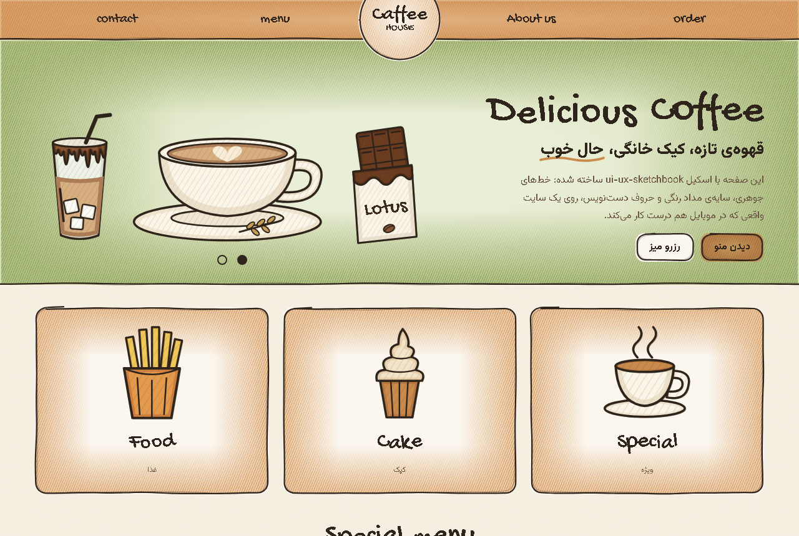
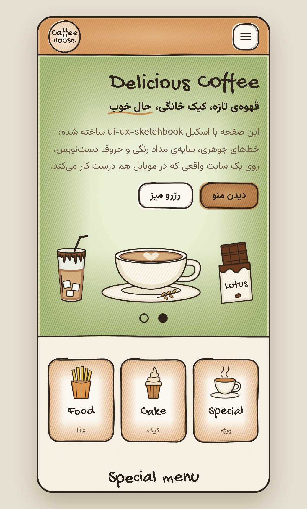

<div align="center">

# ✎ ui-ux-sketchbook

**An agent skill that builds real, responsive websites that look hand-drawn.**

Shaky fine-liner outlines · coloured-pencil shading · hand-lettered titles · ink-and-pencil illustrations · first-class RTL

[](https://github.com/TssHack/ui-ux-sketchbook/actions/workflows/ci.yml)
[](https://github.com/TssHack/ui-ux-sketchbook/releases/latest)
[](LICENSE)
[](https://tsshack.github.io/ui-ux-sketchbook/)

[**Live demo**](https://tsshack.github.io/ui-ux-sketchbook/) · [Install](#install) · [How it works](#how-it-works) · [Changelog](CHANGELOG.md)

&nbsp;

</div>

---

## What it does

Hand your coding agent a **photo of a website sketched on paper**, or ask for a *hand-drawn / sketchbook / doodle* look, and it builds the site the sketch represents, not a picture of it:

- **Reads the sketch for intent.** It picks up section order, brand marks, the colour of each region, and implied behaviour: dots under a hero become a carousel, a cut-off card becomes a scroller, coloured ovals become filters.
- **Builds a working product.** Navigation works on phones, there are clear calls to action, and forms validate and end in a success state.
- **Holds from 320px to desktop**, checked at five widths with an overflow audit.
- **Stays fast.** It uses no SVG filters, keeps a page-weight budget, and has a lite render for small icons.
- **Handles RTL properly.** Persian and Arabic pages, LTR hand lettering inside RTL layouts, and Persian digits accepted in forms.

Works with **Claude Code, Codex, Cursor, Hermes Agent** and any agent that reads `SKILL.md` skills.

## Install

### Claude Code

```text
/plugin install ui-ux-sketchbook --marketplace TssHack/ui-ux-sketchbook
```

<details>
<summary>Older Claude Code, or adding the marketplace yourself</summary>

```text
/plugin marketplace add TssHack/ui-ux-sketchbook
/plugin install ui-ux-sketchbook@tsshack-skills
```
</details>

### Any agent (Codex, Cursor, Claude Code and 40+ others)

```bash
npx skills add TssHack/ui-ux-sketchbook
```

Add `-a codex`, `-a cursor` and so on to pick agents, or `-g` to install globally.

### Hermes Agent, or any agent with an installer script

macOS / Linux:

```bash
curl -fsSL https://raw.githubusercontent.com/TssHack/ui-ux-sketchbook/main/install.sh | sh -s -- --agent hermes
```

Windows (PowerShell):

```powershell
& ([scriptblock]::Create((irm https://raw.githubusercontent.com/TssHack/ui-ux-sketchbook/main/install.ps1))) -Agent hermes
```

| Option | Values |
|---|---|
| `--agent` / `-Agent` | `claude`, `codex`, `cursor`, `hermes`, `all` (default: every agent found on the machine) |
| `--project` / `-Project` | install into the current project instead of your home folder |
| `--dir` / `-Dir` | install into any folder, for agents not listed |
| `--version` / `-Version` | a release tag such as `v1.0.0` (default: latest) |

### Manual

Download `ui-ux-sketchbook.zip` from the [latest release](https://github.com/TssHack/ui-ux-sketchbook/releases/latest) and unzip it into your agent's skills folder:

| Agent | Skills folder |
|---|---|
| Claude Code | `~/.claude/skills/` or `<project>/.claude/skills/` |
| Codex | `~/.codex/skills/` or `<project>/.agents/skills/` |
| Cursor | `~/.cursor/skills/` |
| Hermes Agent | `~/.hermes/skills/` |

Restart the agent after installing.

## Use it

The skill triggers on its own when your request matches. A few prompts that work well:

```text
This is a hand-drawn sketch of my café website. Build it as a real site that keeps the feel of the drawing and works on phones. One index.html I can open directly.
```

```text
Landing page for my sister's bakery in Shiraz, like a page from a sketchbook drawn with pen and coloured pencils: round logo in a top band, drawn breads, three cards, opening hours and a cake order form. Persian, RTL.
```

```text
Portfolio for a children's book illustrator: wobbly ink lines, pencil shading, hand-lettered headings, doodles in the margins. Next.js.
```

## How it works

The skill ships the same primitives in **two builds**, and picks one from your request:

| Build | For | You get |
|---|---|---|
| **Plain JS** | single HTML files, static pages, no framework | `data-sketch`, `data-hand` and `data-art` attributes, a working starter page, and a script that inlines everything into one file |
| **React** | Next.js / React projects | `<SketchBox>`, `<Drawing>`, `<HandText>` and `<SketchDefs>` components |

```html
<section data-sketch="bottom" data-tint="#8fa45c">…</section>     <!-- band with one rough edge -->
<a class="card" data-sketch data-tint="#d08a45">…</a>               <!-- framed, pencil-shaded card -->
<h2><span data-hand>Special menu</span></h2>                        <!-- hand lettering -->
<span data-art="latte" data-label="Latte" data-draw-in></span>     <!-- illustration that traces itself in -->
```

```tsx
<SketchBox as="section" edges={["bottom"]} tint="#8fa45c">…</SketchBox>
<Drawing spec={latte} label="Latte" className="draw-in" />
<HandText text="Special menu" />
```

**Under the hood**
- **Outlines** are seeded wobbly geometry that overshoots where the pen lifts, drawn twice like a fine-liner. They are never filters.
- **Pencil shading** is a hatch pattern plus colour gathered along the inside edges, through clipped strokes in SVG and CSS masks on HTML boxes.
- **Illustrations** are data: shapes with fill, shading and ink. 15 come ready (café and food); `references/drawing.md` shows how to draw new ones.

## Repository layout

```
.claude-plugin/          plugin.json + marketplace.json (Claude Code)
skills/ui-ux-sketchbook/
  SKILL.md               the instructions agents follow
  assets/                sketch.css, vanilla/ (plain JS + starter), components/ (React), illustrations
  references/            responsive checklist, drawing guide
  scripts/               inline_assets.py, audit-overflow.js
examples/cafe/           the live demo's source
install.sh, install.ps1  installers for Claude Code, Codex, Cursor, Hermes and custom folders
tools/                   validate.py, build.py, TypeScript config
evals/                   prompts used to test the skill
```

## Development

```bash
npm install          # TypeScript + React types, for the type-check only
npm run check        # validate the skill, syntax-check JS, type-check React, build packages and the demo
```

**Releasing:** bump `version` in `.claude-plugin/plugin.json` and `package.json`, add a section to `CHANGELOG.md`, then tag:

```bash
git tag v1.1.0 && git push origin v1.1.0
```

The **Release** workflow validates that the tag matches the version, builds `ui-ux-sketchbook.zip`, `.tar.gz`, `.skill` and `SHA256SUMS`, and publishes a GitHub release with notes from the changelog. Pushes to `main` redeploy the demo.

## Contributing

Issues and pull requests are welcome. Run `npm run check` before opening a PR; CI runs the same checks, the Claude Code plugin validator and the installers on Linux and Windows.

## License

[MIT](LICENSE) © Ehsan Fazli

---

<div dir="rtl">

### فارسی

**ui-ux-sketchbook** اسکیلی برای ایجنت‌های برنامه‌نویسی است. از روی عکس یک طرح دستی، یک سایت واقعی و ریسپانسیو می‌سازد که ظاهر نقاشی با خودکار و مداد رنگی دارد: خط‌های جوهری لرزان، سایه‌ی مداد رنگی، تیترهای دست‌نویس و تصویرهای کشیده‌شده. از فارسی و راست‌به‌چپ کامل پشتیبانی می‌کند.

نصب در Claude Code:

</div>

```text
/plugin install ui-ux-sketchbook --marketplace TssHack/ui-ux-sketchbook
```
